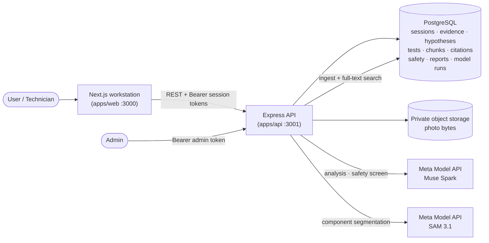

# Architecture

## System diagram



Data flows: the browser never touches the database, storage, or
model credentials. Every AI call originates server-side, validates
against the shared contracts, and persists metadata (never prompts
or keys) to `model_runs`.

## Monorepo layout

```text
apps/
  web/                  Next.js frontend — presentation only, no secrets
  api/                  Express backend — owns workflow, safety, data, AI calls
packages/
  contracts/            Shared zod schemas + inferred TS types (single source of truth)
docs/                   Product-adjacent engineering docs
```

npm workspaces link `@fieldfix/contracts` into both apps. The contracts
package compiles to `dist/` before any app builds, typechecks, tests, or
dev-server starts (via `pre*` hooks), so API and web always validate
against the same schemas.

## Request flow (current)

```text
browser → Next.js (3000) → fetch → Express (3001) → zod-validated JSON
```

- `GET /health` returns `HealthResponse`.
- `/api/v1/sessions` implements session creation, bearer-token-gated
  retrieval, evidence upload/list/download (see [API.md](./API.md)).
  Uploads validate type/size/magic bytes server-side; bytes go to
  private object storage (`StorageAdapter`, local driver by default)
  and only metadata to PostgreSQL.
- `/api/v1/sessions` also mounts the diagnostics loop
  (analyze/hypotheses/tests/results/citations/report), the safety
  transitions, and the segmentation routes; `/api/v1/knowledge` and
  `/api/v1/admin` mount retrieval and ingestion.
- Unknown routes and crashes return the `ApiError` envelope; stack traces
  never leave the server.

## Decisions

- **Separate Express backend**, not Next.js route handlers, per the PRD:
  the diagnostic workflow, safety policy, and Meta API integrations stay
  backend-owned and independently testable.
- **Env validation at startup** (`apps/api/src/env.ts`): the API fails
  fast on bad config. Web env has a documented default so the page renders
  even without a `.env.local`.
- **CommonJS for API/contracts, ESM/bundler for web**: matches each
  runtime's native module system; contracts ship CJS + `.d.ts`.
- **Tailwind v4 + shadcn/ui (new-york)**: theme tokens in
  `app/globals.css`, primitives in `components/ui/`, workstation panels
  in `components/workstation/`. Dark charcoal surfaces, cyan accents,
  visible focus rings, reduced-motion support.
- **Tests**: vitest everywhere. Contracts test schema accept/reject, API
  tests `/health` + 404 via supertest, upload-validation units, and DB
  integration tests against real PostgreSQL (sessions, access control,
  uploads, downloads, storage-failure cleanup). Web tests `cn`, env
  defaults, formatters, the checklist reducer, demo-fixture validation
  against contracts, the API client, and the session store.

## Frontend workstation

`apps/web` renders the engineering dashboard from a local demo dataset
(`lib/demo-data.ts`) until the session/evidence endpoints exist. Every
fixture is built with the shared contract schemas, and an integrity
check guards the loader so broken fixtures render the error state. All
demo and model-labelled content carries explicit "demo" badges; nothing
claims live AI integration. Layout: sidebar nav, evidence canvas with
toggleable annotation overlays, hypothesis panel, guided checklist with
local result capture, source references, persistent safety status, and
an activity feed. Desktop uses a three-column grid; mobile uses an
accessible tabbed view with the nav in a sheet.

## Data layer

PostgreSQL 16 via Kysely (`apps/api/src/db/`): `database.ts` holds the
typed `Database` interface and pool, `migrations/` the versioned DDL,
`repositories/` one typed class per aggregate, and `workflows.ts` the
multi-write transactions (test-result recording, safety transitions).
`nodenext` module resolution is set on the API workspace because Kysely
ships its migrator under the `kysely/migration` subpath. Full details:
[DATABASE.md](./DATABASE.md).

## Knowledge ingestion

`apps/api/src/ingestion/` implements PRD §5: a permitted-source
registry (fail-closed, licence-ack-gated connectors), format parsers
(PDF via pdfjs-dist with page numbers and a font-size heading
heuristic, MyFixit/generic JSON incl. JSONL, CSV, text/Markdown),
OCR only for pages without a text layer (`pdftoppm` + `tesseract`
when installed, otherwise recorded as skipped), size-bounded
chunking with safety-tag detection, SHA-256 duplicate detection, and
per-attempt job rows. Connectors exist for local MyFixit checkouts
and single explicit iFixit guides (mock-tested; live use needs the
licence acks). Retrieval serves `approved` + `indexed` chunks only,
and `CitationService` refuses excerpts that aren't verifiably inside
a real passage. Details: [DATA_SOURCES.md](./DATA_SOURCES.md),
[API.md](./API.md#admin-ingestion).

## Diagnostic engine

`apps/api/src/diagnostics/engine.ts` owns the loop: `analyze` runs
the reasoning service and applies the validated assessment in one
transaction (hypothesis create/update with merged evidence refs,
model-observation rows, proposed tests, workflow events);
`recordResult` stores the user-reported result via the existing
`recordTestResult` workflow and reassesses; `verifyHypothesis` is
the only route to `verified` (technician mode + rationale + event);
`getReport` compiles a deterministic snapshot from stored rows. A
narrow keyword screen (`safety-screen.ts`, interim until the PRD
§4.7 safety controller) classifies proposals as
safe/caution/blocked; blocked tests can never become current and
refuse results. Analysis refuses to run in `critical_stop`.

## Safety controller

`apps/api/src/safety/` implements PRD §4.7: `SafetyController`
matches hazard patterns deterministically (critical/caution rule
sets, no model calls), escalates automatically but only upward,
and gates resumption behind technician transitions
(`critical_stop` → `review_required` → `normal`/`caution`) with
rationale, all audited in append-only `safety_events`.
`SafetyScreeningService` adds an advisory model screen through the
verified Meta provider (strict JSON output): a positive screen can
only raise `review_required`, a negative screen changes nothing,
and any failure degrades to deterministic-only. Llama Guard 4 is
not integrated (unverified endpoint). The loop
(analyze/record/verify) is blocked in `critical_stop` and
`review_required`; uploads, reads, reports, and transitions stay
open. Full policy: [SAFETY_POLICY.md](./SAFETY_POLICY.md).

## Segmentation (optional component localization)

`apps/api/src/vision/` implements PRD §11.5 localization:
`SamSegmentationAdapter` (the only `SegmentationProvider`) calls
`sam-3.1` over streaming SSE, one concept prompt per call, and
validates the box/mask token grammar with the official
`@meta-sam/parser` plus FieldFix-side guards.
`SegmentationService` resolves explicit concepts or deterministic
device vocabularies (`components.ts`), then persists box+mask
annotations with source image dimensions and per-concept
`segmentation` run rows in one transaction — all-or-nothing, never
touching hypotheses/tests/reports. The frontend
(`segmentation-layer.tsx`) renders boxes and server-rendered mask
SVG paths as an overlay over the untouched original photo, with
loading/error/empty states. Labels come from prompts only:
localization, never fault diagnosis.

## Explicitly not built yet

Llama Guard 4 adapter (Muse Spark and SAM 3.1 are integrated),
rate limiting, image-based hazard detection, and frontend wiring
for the knowledge/admin/diagnostics/safety endpoints.
